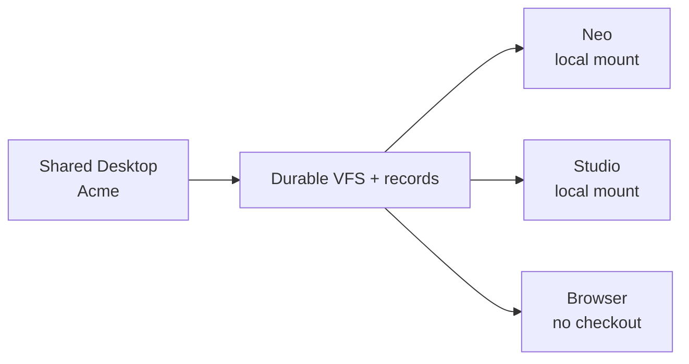

# Desktops

Status: **design, 2026-11-07.** This note fixes the vocabulary and the
boundary between a Desktop, a Project, a Thread, a Worktree, a Checkout, and
the runtime session that Mush uses.

## Definition

A **Desktop** is a durable, synced top-level namespace for one major context of
work.

A **Shared Desktop** is a Desktop with more than one principal.

Examples:

```text
Personal Desktop
FPL Desktop
Elmers Desktop
Acme Desktop
```

A Desktop is the user's "shared home" for a body of work, but it is not a POSIX
home directory and it is not a host folder. It is a capability-scoped VFS
namespace plus the records, projects, Canvas views, and grants attached to it.

A Desktop follows the principal across machines. Its **local materialization**
does not: each machine gets its own mount root and checkouts.

## Vocabulary

| Term | Meaning | Durable? | Shared? |
|---|---|---|---|
| **Desktop** | Top-level namespace for a major context | Yes | Personal or shared |
| **Shared Desktop** | Desktop with multiple principals | Yes | Yes |
| **Project** | Git repository referenced by a Desktop | Yes | Per Desktop policy |
| **Thread** | Conversation plus its project worktrees | Yes | Per thread policy |
| **Worktree** | A thread's version of one project | Yes | Per thread policy |
| **Checkout** | Materialized worktree files on one machine | Local | Per device |
| **Canvas** | Visual projection of a Desktop | Yes | Per Desktop policy |
| **Mush session** | Local shell/VFS execution context | Local | Per device |

`Workspace` should not be a user-facing synonym for any of these. If the word
survives internally, it should mean only the local VFS/session context.

## The hierarchy

```text
Desktop / Shared Desktop
  ├─ projects/
  │    ├─ Project A
  │    │    ├─ Thread 1 worktree -> checkout on Neo
  │    │    └─ Thread 2 worktree -> checkout on Studio
  │    └─ Project B
  ├─ notes/
  ├─ scratch/
  ├─ commands/
  ├─ records bindings
  ├─ Canvas layouts + Desktop theme
  └─ threads/
       ├─ conversation and comments
       └─ project worktrees
```

A Desktop can contain many projects. A `ProjectRef` can be re-used in many
Desktops, but that is a **reference**, not a shared mutable instance. Each
Desktop attaches the same upstream repository and gets its own thread
worktrees and checkouts. Use this for public/FOSS repositories that people want
in more than one Desktop. Changes leave a Desktop through Git upstream, a PR,
or an explicit assignment; they never write through another Desktop's checkout.

## Object model

```text
Desktop
  id              stable, opaque
  name            presentation only
  scope           personal | team | org
  owner           principal or team
  members         principal -> role
  generation      changes on membership/visibility/theme changes

ProjectRef
  project_id      stable repository identity
  repo            source remote
  default_branch

DesktopMount
  path            VFS path, e.g. projects/crm
  source          project worktree | vfs subtree | scratch

DesktopTheme
  background      image, colour, or gradient
  accent
  density?

CanvasLayout
  id
  desktop_id
  name
  layout          panels, arrangement, saved state
```

The manifest is structured state and belongs in `soil:records`; files and
snapshots belong in `soil:vfs`. Do not store a project as a copied directory
inside the Desktop VFS.

## Where a Desktop lives

```text
Desktop manifest       soil:records, one book selected by host/principal
Desktop files          soil:vfs namespace rooted at the Desktop
Project references     manifest, not file copies
Thread worktrees       VFS histories scoped to the thread and project
Checkouts              local filesystem, one per device/participant
Canvas layouts         records or VFS metadata, scoped to the Desktop
```

The Desktop is the durable namespace. The checkout is a disposable projection
of a thread worktree.

## Following machines

Yes: **Desktops must follow the principal across machines.**



The stable identity is the Desktop ID. The local mount path is arbitrary:

```text
Neo:    ~/Desktops/acme
Studio: /Volumes/work/acme
Web:    no host path
```

Sync responsibilities:

- **Mycelium** proves the principal, device, team membership, and grants.
- **Records/VFS sync** carries the manifest, VFS namespace, and content.
- **Unibus** may carry invalidations, presence, and change notifications.
- **Delta** may be one optional thread/ACP client. It is not the Desktop store.

A Desktop does not depend on DeltaDB. DeltaDB is proprietary and tightly
coupled; it can remain an optional adapter.

## Permissions

A Desktop is a scope, not a grant.

```text
principal -> Desktop membership role
Desktop role -> project mount visibility
Thread share -> narrower than Desktop membership
Project worktree -> still subject to thread/principal policy
```

Rules:

- No path escapes a Desktop root.
- A Desktop member does not automatically see every thread in it.
- A thread share does not grant Desktop membership.
- Leaving a Shared Desktop removes local mounts and cached content according to
  policy; it does not silently retain a readable local copy.
- `$HOME` is not the Desktop. The OS home remains private to the POSIX user.

## Canvas

A Desktop is the data/scope. Canvas is the visual projection.

```text
Desktop -> one or more Canvas layouts
Layout -> panels, open projects, camera, filters
Theme -> Desktop-scoped background/accent
```

Switching Desktops in Canvas must visibly change:

- background and accent theme;
- project set;
- records scope;
- open threads/panels;
- visible services and pinned commands.

A Canvas layout belongs to exactly one Desktop. It must not retain a mix of
projects or records from another Desktop. If a user opens the same layout in a
new Desktop, the layout is copied, not shared.

`Canvas Workspace` should mean "a saved Canvas layout for a Desktop," not a
second storage container.

## Mush

Mush runs **inside** a Desktop session.

```sh
mush --desktop acme
```

or:

```toml
# ~/.config/fungos/mush/config.toml
desktop = "acme"
```

A Mush session carries:

```text
desktop_id
local_session_id
principal
device
mount_root
cwd
environment
cancellation token
```

A Desktop may contain multiple project mounts:

```text
/
  projects/
    crm/       -> checkout of thread worktree
    fleet/     -> checkout of thread worktree
  notes/
  scratch/
  commands/
```

Short term, Mush has one VFS root. A Desktop with multiple projects can either:

1. mount one project at a time, or
2. gain a VFS mount table and expose `projects/<name>` as nested roots.

The long-term shape is the mount table. The Desktop is the root; projects are
mounts, not copies.

### First worktree slice

Mush now has `mush tree` and `mush worktree` commands for content-addressed tree
snapshots and thread-owned worktree records. They store `thread`, `worktree`,
`tree`, `ref`, and `checkout` records in `soil:records` and can materialize a
tree into a VFS path. This is the substrate for the per-thread worktrees below;
it is not yet a mount table, checkout reconciliation, or peer sync. See
[Mush worktrees](mush.md#worktrees-and-trees).

## Threads and worktrees

A thread is a conversation plus the worktrees it creates.

```text
Desktop acme
  Project crm
    Thread 42
      worktree w42-crm
        checkout on Neo
  Project fleet
    Thread 42
      worktree w42-fleet
        checkout on Neo
```

Rules:

- A thread belongs to one Desktop for permission and namespace purposes.
- A thread can touch one or more projects in that Desktop.
- Each project gets a thread-scoped worktree.
- Forks get their own worktrees; they do not share mutable worktree state.
- A Desktop can outlive every thread in it. Threads can be archived without
  deleting the Desktop.

## Storage split

```text
Desktop manifest / membership    soil:records
Desktop files and snapshots      soil:vfs
Project identity and remotes     ProjectRef in manifest
Thread worktree history          VFS history scoped by thread/project
Canvas layout and theme          records or VFS metadata
Command roots                    Desktop-scoped host config
```

Do not put a project checkout inside the Desktop VFS as the source of truth.
The checkout is a local projection of a worktree.

## Offline and reconciliation

A Desktop follows a principal across machines, including offline work.

- The Desktop ID is stable across devices.
- The manifest has a generation; stale local manifests are detected.
- VFS writes carry revisions/content ids; conflicts are explicit.
- Project checkouts sync from their worktree, not by copying the Desktop root.
- A machine that has been offline reconciles manifest, VFS history, and
  worktree refs before serving a stale checkout.

Do not silently replace a local checkout with a remote snapshot. Show the
reconciliation state and let the thread/worktree policy decide.

## Lifecycle

```text
create Desktop
  -> choose scope (personal/team/org)
  -> choose owner
  -> create default Canvas/theme
  -> create VFS root
  -> bind records book(s)

join Shared Desktop
  -> verify principal + invite/grant
  -> fetch manifest
  -> mount only visible projects
  -> materialize checkouts on demand

leave/revoke
  -> remove mounts and local caches per policy
  -> retain no readable Desktop content

archive
  -> Desktop remains durable
  -> checkouts may be removed
  -> restore by mounting again
```

## Acceptance tests

1. Create a Personal Desktop, add a project, open it in Canvas, and run Mush
   against the same Desktop.
2. Switch from Desktop A to Desktop B in Canvas; background, theme, projects,
   records scope, and open panels change together.
3. On machine B, sign in as the same principal and see the same Desktop with a
   different local mount path.
4. Share a Desktop with a second principal; they see only projects and threads
   allowed by their role.
5. Offline edit on machine B; reconnect and reconcile without replacing the
   local checkout silently.
6. Mush `cd /projects/<name>` resolves to the thread worktree checkout, not a
   copied directory inside the Desktop VFS.
7. Add the same public repository to two Desktops. Each Desktop creates an
   independent thread worktree; neither Desktop can write through the other's
   checkout.

## Non-goals

- A Desktop is not a POSIX account or `$HOME` replacement.
- A Desktop is not a Git worktree implementation.
- A Desktop is not a thread.
- A Desktop is not a DeltaDB dependency.
- A Desktop does not grant access merely by being named in a path.

## Open decisions

1. Desktop IDs: opaque UUID, or `org/team/name` with an opaque suffix?
2. Can a thread span projects from two Desktops? Recommendation: no. A
   `ProjectRef` may be attached to many Desktops, especially for public/FOSS
   repositories, but every use gets its own thread worktree. Do not share one
   mutable project instance across two Desktops; cross-Desktop work goes through
   Git upstream, a PR, or an explicit assignment.
3. Is Desktop membership itself a `soil:records` schema, or host policy backed by
   Mycelium grants? Recommendation: manifest in records, authority in Mycelium.
4. Does `soil:doc` become a Desktop text-buffer capability, or remain a VFS text
   layer? Recommendation: VFS text first; `soil:doc` only if editor semantics
   need a stable capability.
