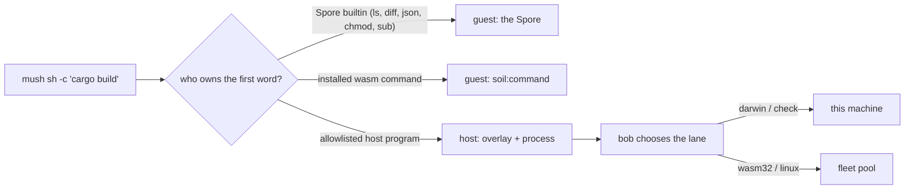
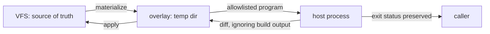
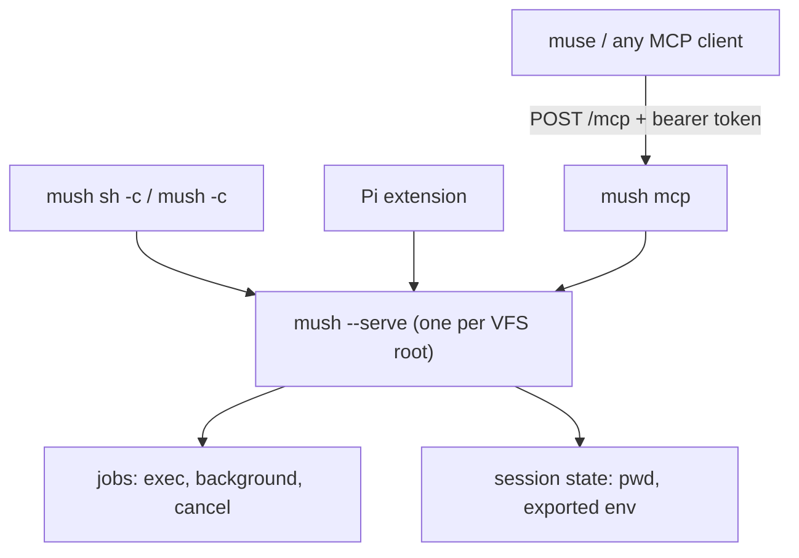

# Mush: where it lives and how it fits together

Mush is a shell over one VFS workspace. It is the substrate, not the policy:
the namespace is `fungos-vfs`, the build plane is `bob`, and mush is the thing
that gives an agent a prompt over both.

## The map

| Piece | Where | What it owns |
| --- | --- | --- |
| Host binary | [`crates/mush`](../crates/mush) | the VFS root, the grants, the daemon, the overlay, the MCP endpoint |
| The Spore | [`spores/mush`](../spores/mush) | shell parsing, builtins, job control, the prompt; compiled to `wasm32-wasip2` and embedded in the host binary |
| VFS host | [`crates/soil-vfs-host`](../crates/soil-vfs-host) | `soil:vfs`, `soil:vfs-mut`, `soil:index` implementations; the derived index |
| HTTP host | [`crates/soil-http-host`](../crates/soil-http-host) | the `soil:http` contract: origin allowlist, budget, credentials, transport |
| Net host | [`crates/mush/src/net.rs`](../crates/mush/src/net.rs) | `soil:net`: bounded resolve and TCP probe |
| Contracts | [`wit/`](../wit) | `soil-vfs`, `soil-vfs-mut`, `soil-http`, `soil-net`, `soil-index`, `soil-command`, `soil-principal` |
| Spore dependencies | [`spores/mush/wit/deps`](../spores/mush/wit/deps) | the vendored copies the guest compiles against |
| Pi integration | [`integrations/pi`](../integrations/pi) | the Pi extension, the MCP contract, the harness and agent test |
| Shell docs | [`docs/mush.md`](mush.md) | the user surface: syntax, commands, config, doctor |
| Operator docs | [`docs/mush-operator.md`](mush-operator.md) | running it for other people, service accounts |

FungOS-linux keeps three things outside this repository:

| Repo | What mush gets from it |
| --- | --- |
| [`fungos-vfs`](https://github.com/fungOS-linux/fungos-vfs) | the namespace and content store: `Vfs`, `FileEntry` (including `mode`), sync, worktree primitives |
| [`bob`](https://github.com/FuturePresentLabs/bob) | the build plane: which lane a target goes to, per-agent `CARGO_HOME`, sccache, the fleet pool |
| `mycelium` | identity and reachability. mush takes a principal string and uses it for the fetch policy, but does **not** verify it; the verifier (`crates/soil-principal-host`, a Mycelium CLI caller) exists and is not linked into mush. The `soil:mycelium` contract — directory plus remote session with host-key verification — is defined in `wit/` and has no host implementation yet. |

So: **mush lives in `soil`**. It reads the namespace from `fungos-vfs` and asks
`bob` where a build runs; it owns neither.

## One command, three places it can run

The routing rule lives in two named lists, not scattered ifs:
`shell::SPORE_OWNED` (names the Spore must win even though the host allowlist
also has them) and `shell::HOST_ALLOWLIST` (the one host policy). A name in
neither goes to the Spore, which reports it as unknown.

## The host bridge

A host program never sees the VFS. It sees a materialized copy:

- Build output (`target/`, `node_modules/`, `dist/`, ...) is ignored in both
  directions, so a build never writes artifacts into the VFS.
- File modes travel: the overlay writes each file with the mode the VFS
  remembers, and a mode-only change is applied with `set_mode` rather than a
  content rewrite.
- A mode change is entry metadata, not a new version — `chmod +x` does not read
  as a history rewrite.

## Builds, in one paragraph

`cargo` inside a host command is `bob-cargo`. bob's environment is applied to
every host process whose program is a build (`cargo`, `rustc`, a C compiler,
`make`, `cmake`, `zig`, `go`, `npm`, `fpl bob`, `bob-cargo`). That environment
owns the per-agent `CARGO_HOME` (so one agent's package-cache lock is not
another's), the sccache wrapper, the pool, and `CARGO_TARGET_DIR` — outside the
overlay, because the overlay is deleted after every command. mush adds the one
fact bob cannot know: this run's overlay joins `SCCACHE_BASEDIRS`, or the
cache key would change with the path every time.

For a remote build, mush also sets `BOB_REMOTE_SESSION` from its session
identity, so repeat builds land in the same remote workspace and reuse the
target. Without it, every mush command is a new remote session.

## The daemon and its surface

- The socket is per root under `~/.local/share/fungos/mush/run/`.
- One worker per daemon: two agents on one root serialize. Two roots are two
  daemons.
- `mush mcp` serves one root and requires a bearer token (`--mcp-token` or
  `MUSH_MCP_TOKEN`); the tools are `mush_exec`, `mush_job`, `mush_cancel`.
- Background jobs live in memory: a daemon restart drops the record and kills
  the child.

## What a line may touch

| Grant | What it allows | Where the policy lives |
| --- | --- | --- |
| `soil:vfs` | list, stat, read a bounded range | host, per workspace |
| `soil:vfs-mut` | write, remove, mkdir, rename, chmod | host, version-fenced |
| `soil:index` | browse, search, knn | derived index, rebuildable |
| `soil:command` | run an installed wasm command | command root |
| `soil:http` | one request with an origin allowlist and a budget | `crates/soil-http-host` + `access.rs` |
| `soil:net` | resolve a name, probe a TCP port | `crates/mush/src/net.rs` |

Access is resolved once per session: `MUSH_PRINCIPAL` / `MUSH_GROUPS` (or the
config file) decide which fetch origins and credentials a caller may use. The
guest names an opaque credential handle; the host injects it. A guest cannot
set its parent's environment, which is what makes that a boundary rather than a
convention.

## Storage, told straight

- Namespace state: `<root>/.vfs-state/vfs.sqlite3` (`.fungos/` on roots an
  older build wrote; readable until migration).
- Content: a machine-wide content-addressed store, not per root. Tests and
  services that need isolation pass an explicit store.
- Derived index: `<root>/.fungos/soil-index.sqlite3`. Deleting it costs a
  rebuild, never data.
- Records (worktrees, trees, checkouts): the configured records root,
  `~/.local/share/fungos/records` by default.
- Session state: `<root>/.fungos/sessions/<key>.json`; history is per user, not
  per root.

## Limits worth knowing

- **A policy boundary, not a sandbox.** An allowlisted program runs as the user
  and can read `$HOME`. Mush decides *what* may run, not what it may see.
- **The shell path inherits the daemon's environment.** `mush run host` starts
  from empty; the shell bridge does not. Until that changes, a host command in
  a shell sees whatever the daemon was started with.
- **One worker per daemon**, one root per MCP server.
- **The overlay is paid per host command.** Cold materialization is linear in
  files; every `git status` pays it once.
- **Indexed listings do not carry the mode yet** (the VFS entry does); the
  authoritative answer is the VFS, not `ls -l` from the index.
- **Identity is a label, not an attestation.** `--principal` is passed to the
  Spore as an argument, and the fetch policy reads `MUSH_PRINCIPAL` /
  `MUSH_GROUPS` from the host environment. A guest cannot set that environment,
  so it is a real boundary for the guest — but nobody verifies the claim. Wiring
  `crates/soil-principal-host` (which verifies a Mycelium principal) is the next
  step, not something mush does today.
